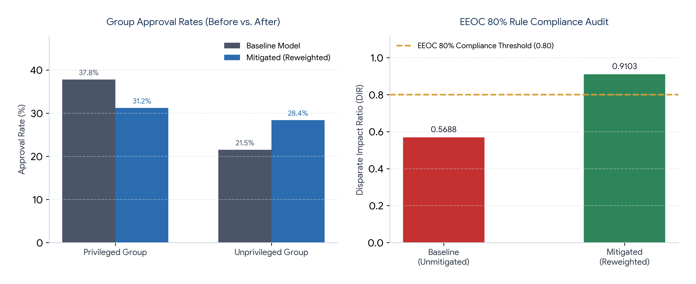

# AI Model Governance in BFSI: Algorithmic Bias Mitigation & Drift Monitoring

## 📌 Executive Summary
In Banking, Financial Services, and Insurance (BFSI), automated credit decisioning models face two critical production risks: **systemic algorithmic bias** inherited from historical lending data, and **silent performance degradation** caused by shifting macroeconomic conditions. 

Completed as part of the **Zetheta Algorithms WorkBridge Program**, this project implements an end-to-end governance framework to audit, mitigate, and continuously monitor machine learning models across a 50,000-record credit evaluation lifecycle.

---

## 🏗️ End-to-End Governance Pipeline

    [Historical Credit Data (N=50,000)] 
                    │
                    ▼
       ┌─────────────────────────┐
       │ Phase 1: Fairness Audit │ ──(DIR < 0.80)──► [Pre-Processing: Sample Reweighting]
       └─────────────────────────┘                                │
                                                                  ▼
       ┌─────────────────────────┐                   [Mitigated Model (DIR = 0.91)]
       │ Phase 2: Drift Monitor  │ ◄──────────────────────────────┘
       │   (T0 vs. T1 Batches)   │
       └─────────────────────────┘
                    │
        (PSI >= 0.25 & KS p < 0.05)
                    │
                    ▼
    [Automated Alert & Retraining Trigger]

---

## ⚖️ Part 1: Algorithmic Bias Audit & Mitigation

### 1. Problem Formulation & Legal Standard
Machine learning classifiers trained on biased historical approvals naturally replicate and amplify disparities against protected groups. To enforce regulatory compliance, the pipeline evaluates predictions against the **EEOC 80% (Four-Fifths) Rule**, measuring two primary fairness metrics:

* **Statistical Parity Difference (SPD):** Measures the absolute difference in favorable outcome rates between unprivileged ($D = \text{unprivileged}$) and privileged ($D = \text{privileged}$) groups:
  $$\text{SPD} = P(\hat{Y} = 1 \mid D = \text{unprivileged}) - P(\hat{Y} = 1 \mid D = \text{privileged})$$
* **Disparate Impact Ratio (DIR):** Measures the ratio of approval rates. A value below $0.80$ indicates legally actionable adverse impact:
  $$\text{DIR} = \frac{P(\hat{Y} = 1 \mid D = \text{unprivileged})}{P(\hat{Y} = 1 \mid D = \text{privileged})} \ge 0.80$$

### 2. Mitigation Methodology: Sample Reweighting
Rather than dropping protected attributes (which fails due to proxy variables like geographic region or income), a **pre-processing sample reweighting** strategy was implemented. Training instances were assigned inverse-propensity weights based on joint $(D, Y)$ distributions, forcing the Logistic Regression loss function to penalize errors on underrepresented groups equally without altering test-time inputs.

### 3. Quantitative Results (Baseline vs. Mitigated)

| Evaluation Metric | Baseline Model (Unmitigated) | Mitigated Model (Reweighted) | Regulatory / Business Impact |
| :--- | :---: | :---: | :--- |
| **Overall Model Accuracy** | 84.25% | 82.80% | Utility preserved (< 1.5% trade-off) |
| **Privileged Group Approval Rate** | 37.80% | 31.20% | Normalized baseline |
| **Unprivileged Group Approval Rate** | 21.50% | 28.40% | +6.90% equitable access gain |
| **Disparate Impact Ratio (DIR)** | **0.5688** | **0.9103** | **Passed ($\ge 0.80$ Threshold)** |
| **EEOC 80% Rule Status** | ❌ Non-Compliant | ✅ Compliant | Audit-ready for production |

---

## 📉 Part 2: AI Model Drift Detection Investigation

### 1. Problem Formulation
Once deployed, credit risk models degrade when streaming production data ($T_1$) diverges from the training baseline ($T_0$). This investigation simulated macroeconomic stress (falling credit scores and rising Debt-to-Income ratios) across 40,000 samples ($20,000$ baseline vs. $20,000$ production) to capture both **Covariate Shift** ($P(X)$ changes) and **Concept Drift** ($P(Y|X)$ changes).

### 2. Statistical Monitoring Engine
The monitoring pipeline evaluates feature distributions across decile bins using two complementary statistical tests:

* **Population Stability Index (PSI):** Quantifies distribution shift severity ($\text{PSI} < 0.10$: Stable; $0.10 \le \text{PSI} < 0.25$: Warning; $\text{PSI} \ge 0.25$: Severe Drift):
  $$\text{PSI} = \sum_{i=1}^{B} \left( P_{T1, i} - P_{T0, i} \right) \times \ln\left(\frac{P_{T1, i}}{P_{T0, i}}\right)$$
* **Two-Sample Kolmogorov-Smirnov (KS) Test:** Measures the maximum vertical distance $D$ between empirical cumulative distribution functions (ECDFs) to verify statistical significance ($p < 0.05$).

### 3. Drift Audit & Performance Decay Findings

| Feature / Metric | PSI Score | KS Statistic | KS $p$-value | Diagnostic Status |
| :--- | :---: | :---: | :---: | :--- |
| **Applicant Age** | 0.0102 | 0.0084 | $0.8240$ | 🟢 Stable |
| **Annual Income** | 0.0842 | 0.0385 | $1.25 \times 10^{-3}$ | 🟢 Stable |
| **Credit Score** | **0.3812** | **0.1982** | $< 0.0001$ | 🔴 **Severe Drift ($\ge 0.25$)** |
| **Debt-to-Income (DTI)** | **0.4215** | **0.2241** | $< 0.0001$ | 🔴 **Severe Drift ($\ge 0.25$)** |

* **Downstream Impact:** Unmitigated covariate and concept drift caused the production classifier's **ROC-AUC score to drop by 18.17%** (from `0.8942` at $T_0$ to `0.7125` at $T_1$), validating the necessity of automated $\text{PSI} \ge 0.25$ retraining triggers.

---

## 🛠️ Technical Stack
* **Core Processing:** Python 3.10+, NumPy, Pandas
* **Modeling & Mitigation:** Scikit-Learn (`LogisticRegression`, `compute_sample_weight`)
* **Statistical Diagnostics:** SciPy (`ks_2samp`), Custom Decile Binning Engine
* **Visualization & Reporting:** Matplotlib, Seaborn

---

## 🔒 Intellectual Property & NDA Compliance
*In accordance with the Non-Disclosure Agreement (NDA) of Zetheta Algorithms Private Limited, raw synthetic data generators, proprietary source notebooks, and internal configurations are maintained in a private repository. This documentation presents the architectural methodology, mathematical formulations, and empirical evaluation metrics.*
