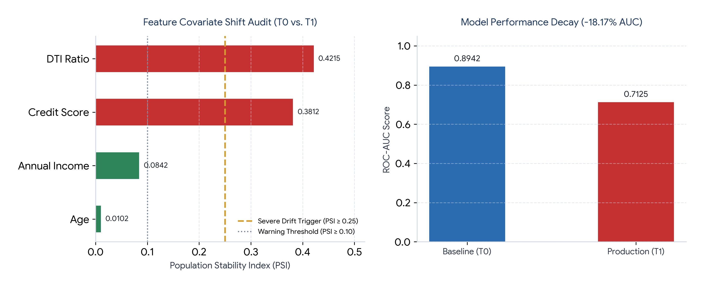

# AI Model Governance in BFSI: Algorithmic Bias Mitigation & Drift Monitoring

## Overview
Automated credit decisioning models in Banking, Financial Services, and Insurance (BFSI) face two major risks once deployed: **algorithmic bias** learned from historical approval records, and **silent performance decay** caused by shifting economic conditions.

Completed during my project work experience with **Zetheta Algorithms**, this case study outlines a two-stage governance pipeline built to audit, mitigate, and monitor credit risk models across a 50,000-record lifecycle.

---

## System Pipeline

    [Historical Credit Data (N=50,000)] 
                    │
                    ▼
       ┌─────────────────────────┐
       │ Phase 1: Fairness Audit │ ──(DIR < 0.80)──► [Pre-Processing: Sample Reweighting]
       └─────────────────────────┘                                │
                                                                  ▼
       ┌─────────────────────────┐                   [Mitigated Model (DIR = 0.91)]
       │ Phase 2: Drift Monitor  │ ◄──────────────────────────────┘
       │   (T0 vs. T1 Batches)   │
       └─────────────────────────┘
                    │
        (PSI >= 0.25 & KS p < 0.05)
                    │
                    ▼
    [Automated Alert & Retraining Trigger]

---

## Part 1: Algorithmic Bias Audit & Mitigation

### Problem & Compliance Standard
Models trained on biased historical lending data tend to reproduce disparities against unprivileged applicant groups. To test for adverse impact under the **EEOC 80% (Four-Fifths) Rule**, I evaluated baseline predictions using two fairness metrics:

* **Statistical Parity Difference (SPD):** The absolute gap in approval rates between unprivileged ($D = \text{unprivileged}$) and privileged ($D = \text{privileged}$) groups:
  $$\text{SPD} = P(\hat{Y} = 1 \mid D = \text{unprivileged}) - P(\hat{Y} = 1 \mid D = \text{privileged})$$
* **Disparate Impact Ratio (DIR):** The ratio of approval rates across groups, where any value below $0.80$ fails compliance:
  $$\text{DIR} = \frac{P(\hat{Y} = 1 \mid D = \text{unprivileged})}{P(\hat{Y} = 1 \mid D = \text{privileged})} \ge 0.80$$

### Mitigation Approach
Simply removing protected attributes from the training features does not fix bias because variables like region and income act as proxies. Instead, I used **pre-processing sample reweighting**—assigning inverse-propensity weights based on joint $(D, Y)$ distributions so the Logistic Regression loss function penalizes errors on underrepresented groups equally without changing inference-time inputs.

### Results: Baseline vs. Mitigated Model

| Metric | Baseline Model | Mitigated Model (Reweighted) | Outcome |
| :--- | :---: | :---: | :--- |
| **Overall Accuracy** | 84.25% | 82.80% | < 1.5% accuracy trade-off |
| **Privileged Group Approval Rate** | 37.80% | 31.20% | Normalized baseline |
| **Unprivileged Group Approval Rate** | 21.50% | 28.40% | +6.90% approval rate gain |
| **Disparate Impact Ratio (DIR)** | **0.5688** | **0.9103** | **Compliant ($\ge 0.80$)** |
| **EEOC 80% Rule Status** | Non-Compliant | Compliant | Cleared for deployment |

---

## Part 2: Model Drift Detection & Performance Decay

### Problem Formulation
After deployment, credit risk models lose accuracy when live applicant data ($T_1$) shifts away from the training distribution ($T_0$). To test model resilience under economic stress (lower credit scores and higher debt-to-income ratios), I evaluated 40,000 records ($20,000$ baseline vs. $20,000$ production) for both **covariate shift** ($P(X)$) and **concept drift** ($P(Y|X)$).

### Monitoring Methodology
The monitoring script tracks feature distributions across decile bins using two statistical checks:

* **Population Stability Index (PSI):** Measures how much a feature distribution has shifted ($\text{PSI} < 0.10$: Stable; $0.10 \le \text{PSI} < 0.25$: Warning; $\text{PSI} \ge 0.25$: Severe Drift):
  $$\text{PSI} = \sum_{i=1}^{B} \left( P_{T1, i} - P_{T0, i} \right) \times \ln\left(\frac{P_{T1, i}}{P_{T0, i}}\right)$$
* **Two-Sample Kolmogorov-Smirnov (KS) Test:** Computes the maximum distance $D$ between empirical cumulative distribution functions to verify statistical significance ($p < 0.05$).

### Drift Audit Findings

| Feature | PSI Score | KS Statistic | KS $p$-value | Status |
| :--- | :---: | :---: | :---: | :--- |
| **Applicant Age** | 0.0102 | 0.0084 | $0.8240$ | Stable |
| **Annual Income** | 0.0842 | 0.0385 | $1.25 \times 10^{-3}$ | Stable |
| **Credit Score** | **0.3812** | **0.1982** | $< 0.0001$ | **Severe Drift ($\ge 0.25$)** |
| **Debt-to-Income (DTI)** | **0.4215** | **0.2241** | $< 0.0001$ | **Severe Drift ($\ge 0.25$)** |

* **Impact on Model Performance:** Unaddressed drift caused the classifier's **ROC-AUC to fall by 18.17%** (from `0.8942` at $T_0$ to `0.7125` at $T_1$), confirming the need for automated retraining alerts once $\text{PSI} \ge 0.25$.

---

## Tech Stack
* **Data Processing:** Python, NumPy, Pandas
* **Modeling & Mitigation:** Scikit-Learn (`LogisticRegression`, `compute_sample_weight`)
* **Statistical Testing:** SciPy (`ks_2samp`)
* **Visualization:** Matplotlib, Seaborn

---

## Confidentiality Note
*In compliance with the Non-Disclosure Agreement (NDA) for Zetheta Algorithms Private Limited, proprietary source notebooks and raw synthetic datasets are kept in a private repository. This page documents the architecture, statistical methodology, and evaluation results.*
